# Recall

Recall is a semantic bookmark manager for saving, organizing, and rediscovering links. Instead of requiring an exact keyword match, Recall lets you describe what you remember and searches your saved links by meaning.

It is a portfolio project built around a practical use case for embeddings and vector similarity: turning a growing collection of bookmarks into a searchable personal knowledge base.

## Features

- **Save bookmarks** - Store a URL with optional notes and tags. Recall normalizes the URL and retrieves page metadata when possible.
- **Automatic metadata extraction** - The Supabase Edge Function first reads a page's title and description, then can use Firecrawl as a fallback. If metadata cannot be completed, the bookmark can be finished manually.
- **Notes and tags** - Add personal context and reusable tags while saving or editing a bookmark.
- **Favorites** - Mark important bookmarks as favorites and search within the favorites view.
- **Semantic search** - Search with natural-language descriptions such as “resources for learning React state management,” rather than relying only on exact words.
- **Similar bookmarks** - A bookmark details page can show related saved links based on embedding similarity.
- **Bookmark organization** - Browse the dashboard, favorites, and tag-filtered views in grid or list layout.
- **Authentication** - Register, verify an email address, log in, log out, and delete an account through Supabase Auth.
- **Account settings** - Update the profile avatar, choose light, dark, or system theme, and select the default bookmark layout.
- **Responsive interface** - The application includes desktop navigation and a mobile bottom navigation experience.

The public landing page contains illustrative copy about browser extensions, mobile sharing, and automatic tagging. Those integrations are not present in this repository and are not listed above as implemented features.

## Screenshots

### Landing page

The public landing page introduces Recall and its semantic-search concept.

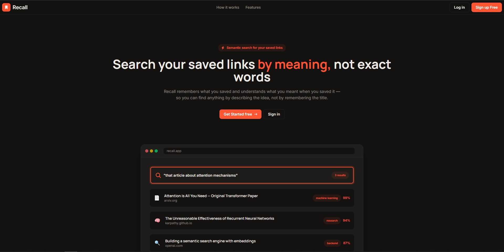

### Dashboard

The authenticated dashboard displays saved bookmarks and provides the main search experience.

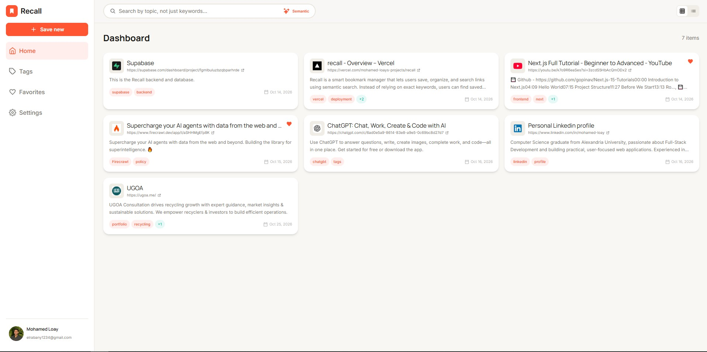

### Semantic search

Describe the topic or idea you remember and Recall returns semantically similar bookmarks.

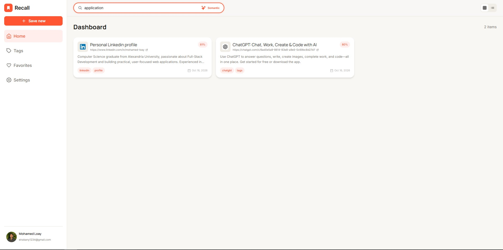

When no saved bookmark meets the search threshold, Recall shows an explicit empty state.

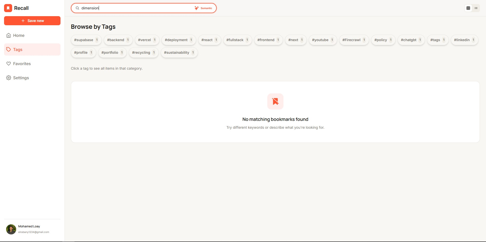

### Add and edit bookmarks

Save a URL with optional notes and tags, then edit the bookmark later.

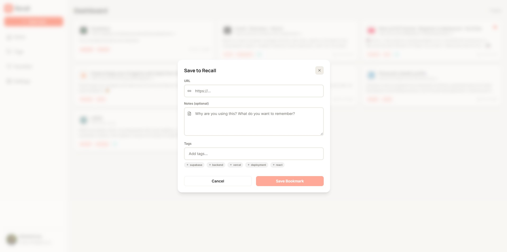

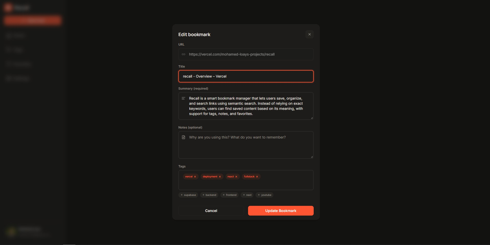

### Bookmark details and recommendations

The details view shows the saved URL, tags, generated summary, personal notes, and related bookmarks when available.

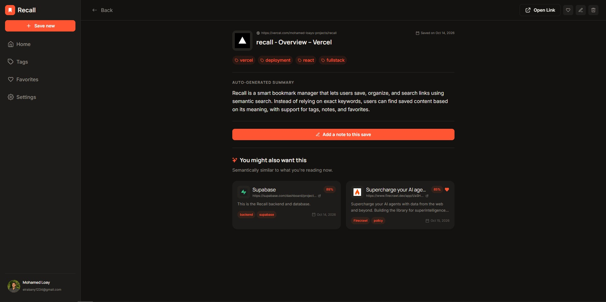

### Favorites and tags

Browse favorite links or filter saved links by tag.

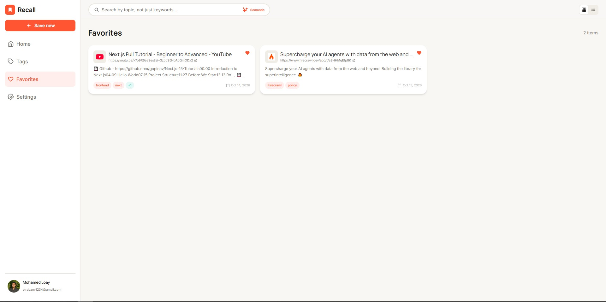

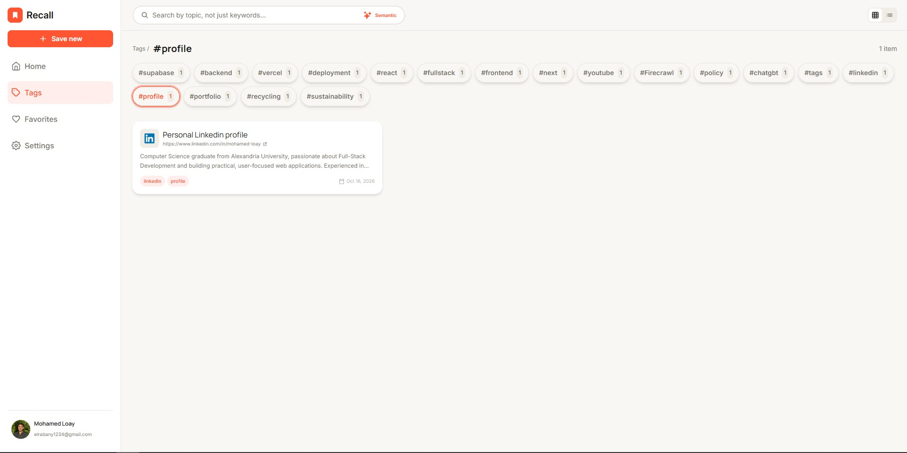

### Authentication and settings

Recall includes registration, login, email verification, profile, appearance, and account-management screens.

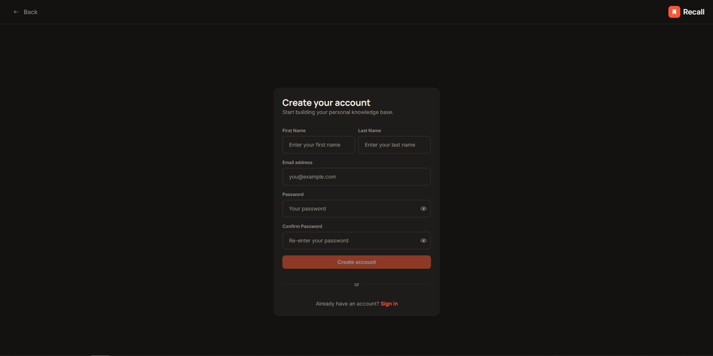

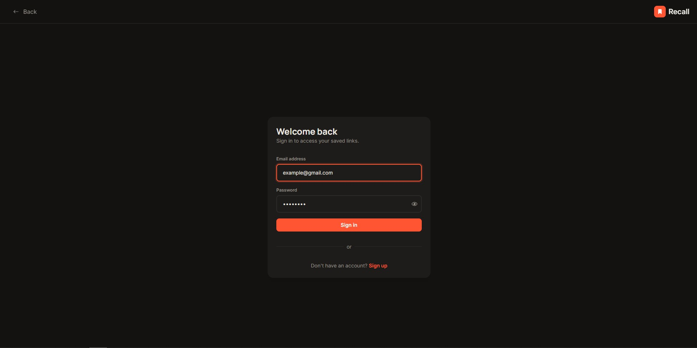

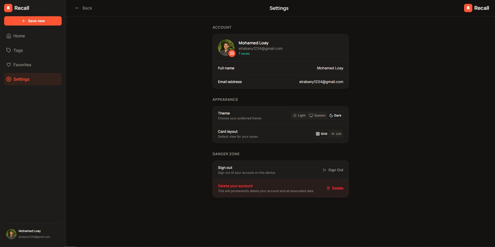

## Technology Stack

### Frontend

- React 19
- TypeScript
- Vite
- React Router 7
- Redux Toolkit and React Redux
- Tailwind CSS 4 with DaisyUI
- Framer Motion
- React Icons
- `react-easy-crop` for avatar editing

### Backend and data services

- Supabase Auth for authentication and sessions
- Supabase JavaScript client for frontend data access
- Supabase Edge Functions for metadata extraction, embedding generation, and account deletion
- PostgreSQL through Supabase
- PostgreSQL vector similarity through the database functions expected by the application
- Firecrawl as an optional metadata-extraction fallback

## How It Works

### Saving a bookmark

1. The user submits a URL, optional notes, and tag names.
2. The frontend calls the `save_bookmark_with_tags` Supabase RPC to save the bookmark and synchronize its tags.
3. The `extract-metadata` Edge Function fetches the page and extracts its title and description. It can fall back to Firecrawl when the native request does not provide complete metadata.
4. Once a title and supporting text are available, Recall builds embedding text from the bookmark title, generated snippet, notes, and tag names.
5. The frontend calls the `generate-embedding` Edge Function. That function uses Supabase AI's `gte-small` model with mean pooling and normalization, and expects a 384-value embedding.
6. The bookmark is updated with the embedding and a processing status. If the required metadata is unavailable, the user is prompted to complete it manually.

### Semantic search

When a query contains at least two characters, the search hook waits 500 ms after the last change before requesting results. The query is converted to the same 384-dimensional embedding format and passed to the `semantic_search_bookmarks` RPC.

The RPC receives:

- The query embedding
- A search scope: all bookmarks, favorites, or a selected tag
- An optional tag ID
- A minimum similarity threshold of `0.80` by default
- A result limit of `10` by default

The database function is responsible for comparing the query vector with stored bookmark vectors and returning the ranked matches. The returned records may include a `similarity` value used by the application.

### Similar-bookmark recommendations

On a bookmark details page, Recall calls the `get_similar_bookmarks` RPC with the current bookmark ID. The database function compares that bookmark's stored embedding with other bookmarks, applies the same default `0.80` similarity threshold, and returns up to two related results by default.

### Supabase and PostgreSQL

The frontend creates a Supabase client with the public project URL and publishable key. Authenticated requests use the current Supabase session and query user-owned data from tables such as `profiles`, `bookmarks`, and `tags`. Bookmark/tag synchronization and vector retrieval are delegated to database RPCs.

The repository also uses an `avatars` Supabase Storage bucket for profile images. The account-deletion Edge Function uses a server-side service-role key only in the Edge Function runtime to remove avatar files and delete the authenticated user.

The repository does not contain database migrations, schema SQL, or function definitions. The exact column types, indexes, Row Level Security policies, foreign keys, cascade rules, and `pgvector` installation must therefore be configured in the Supabase project separately.

## Project Structure

```text
.
├── public/                 # Static assets, favicon, sitemap, and robots.txt
├── screenshots/            # UI screenshots used in this README
├── src/
│   ├── components/         # Reusable UI, layout, landing, settings, and modal components
│   ├── context/            # Cross-page semantic-search context
│   ├── hooks/              # Authentication, bookmark, tag, theme, layout, and search hooks
│   ├── lib/                # Supabase client initialization
│   ├── pages/              # Landing, auth, dashboard, bookmark, tag, favorites, and settings pages
│   ├── routes/             # Public/protected routing and authenticated application layout
│   ├── services/           # Auth, bookmark, tag, user, and semantic-search data operations
│   ├── store/               # Redux store, slices, selectors, and typed hooks
│   ├── types/               # Bookmark, tag, profile, settings, and search types
│   └── utils/               # URL, theme, layout, image, navigation, and status helpers
├── supabase/
│   ├── config.toml         # Supabase local project configuration
│   └── functions/          # Supabase Edge Functions
│       ├── delete-account/
│       ├── extract-metadata/
│       └── generate-embedding/
├── index.html              # Vite HTML entry point
├── package.json             # Dependencies and npm scripts
├── vite.config.ts           # Vite configuration
├── vercel.json              # SPA rewrite and no-index route headers
└── tsconfig*.json           # TypeScript configuration
```

## Getting Started

### Prerequisites

- Node.js with npm
- A Supabase project configured for the tables, policies, RPCs, storage bucket, and Edge Functions described in [Supabase Setup](#supabase-setup)
- A Firecrawl API key if you want the metadata fallback to be available

### Installation

Clone the repository, enter the project directory, and install the dependencies:

```bash
git clone <repository-url>
cd Recall
npm install
```

Create a local environment file with the frontend variables listed in [Environment Variables](#environment-variables), then start the development server:

```bash
npm run dev
```

Vite will print the local URL in the terminal.

### Build and preview

Create a production build:

```bash
npm run build
```

Preview the generated build locally:

```bash
npm run preview
```

Run the configured lint checks:

```bash
npm run lint
```

## Environment Variables

### Frontend variables

The Vite client reads these variables from the local environment:

| Variable | Required | Purpose |
| --- | --- | --- |
| `VITE_SUPABASE_URL` | Yes | Public URL of the Supabase project |
| `VITE_SUPABASE_PUBLISHABLE_KEY` | Yes | Public Supabase publishable key used by the browser client |

Example:

```dotenv
VITE_SUPABASE_URL=https://your-project-ref.supabase.co
VITE_SUPABASE_PUBLISHABLE_KEY=your-public-publishable-key
```

Do not commit real keys or `.env` files. The repository's ignore rules exclude local environment files.

### Edge Function variables

Supabase supplies `SUPABASE_URL` and `SUPABASE_ANON_KEY` to the Edge Functions. The account-deletion function also requires `SUPABASE_SERVICE_ROLE_KEY`, which must remain a server-side secret and must never be exposed through Vite or the browser.

The metadata function optionally reads:

| Variable | Purpose |
| --- | --- |
| `FIRE_CRAWL_KEY` | Enables the Firecrawl fallback when native page metadata is incomplete |

`FIRE_CRAWL_KEY` should be configured as a Supabase Edge Function secret, not as a frontend `VITE_` variable. Native metadata extraction can run without it, but pages that do not expose enough metadata may fall back to manual completion.

## Supabase Setup

The source code expects the following Supabase resources. Their definitions are not included in this repository, so configure and verify them in the Supabase project before using the application.

### Authentication

- Enable Supabase email/password authentication.
- Configure email confirmation and the confirmation redirect used by registration (`/dashboard` on the current site origin).
- Ensure authenticated users can access only their own application data through Row Level Security policies.

### Database resources

The client and Edge Functions reference these resources:

- `profiles` - User profile data, including the full name and avatar URL.
- `bookmarks` - Saved URLs, metadata, notes, favorite state, processing status, and embeddings.
- `tags` - User-owned tag records.
- `bookmark_tags` - The bookmark-to-tag relationship used by nested Supabase queries.
- `save_bookmark_with_tags` - RPC used to create or update a bookmark and synchronize tag names.
- `semantic_search_bookmarks` - RPC used for scoped, thresholded vector search.
- `get_similar_bookmarks` - RPC used for related-bookmark recommendations.

The bookmark `embedding` column and the search RPCs must use a vector-compatible PostgreSQL setup matching the 384-value output from `gte-small`. The repository does not specify the column definition, vector index, SQL body, grants, or RLS policies; those details require manual configuration.

### Storage

Create an `avatars` Storage bucket and configure policies that allow an authenticated user to manage only their own avatar files. The frontend stores public avatar URLs, while the delete-account function removes the user's files before deleting the account.

### Edge Functions

Deploy these functions to the Supabase project:

- `extract-metadata` - Reads a bookmark URL, extracts title and description, and updates the bookmark while it is in processing status.
- `generate-embedding` - Runs Supabase AI's `gte-small` model and returns a normalized 384-value embedding.
- `delete-account` - Verifies the caller's access token, removes avatar files, and deletes the user with server-side admin privileges.

Set the Edge Function secrets described in [Environment Variables](#environment-variables). Deployment, database migrations, and RPC SQL are not automated by the npm scripts in this repository.

## Available Scripts

| Script | Description |
| --- | --- |
| `npm run dev` | Start the Vite development server with hot module replacement |
| `npm run build` | Type-check the project with `tsc -b` and create a Vite production build |
| `npm run lint` | Run ESLint across the project |
| `npm run preview` | Serve the production build locally for verification |

## Build and Deployment

The frontend is a Vite single-page application. Run `npm run build` and deploy the generated `dist/` directory to a static host that supports SPA fallback routing.

The repository includes `vercel.json` with a catch-all rewrite to `/`, plus `X-Robots-Tag: noindex` headers for authenticated routes. This is compatible with a Vercel-style static deployment, but the repository does not include a deployment pipeline or provider-specific project configuration.

Before deploying, configure the frontend environment variables, deploy the three Supabase Edge Functions, set their secrets, and verify the database RPCs, vector support, storage policies, and authentication redirects.

## Future Improvements

Possible follow-up work, clearly separate from the current implementation, includes:

- Add versioned Supabase migrations and RPC definitions to make project setup reproducible.
- Add automated tests for bookmark processing, search scopes, embedding failures, and authorization policies.
- Add a browser extension or mobile share integration if the landing-page concept is developed further.
- Add observability for Edge Function failures and long-running bookmark processing.

## Manual Setup TODOs

- [ ] Provide or create the Supabase database schema, RLS policies, relationships, and RPC definitions.
- [ ] Enable and configure the vector extension and a vector-compatible `bookmarks.embedding` column for 384-dimensional embeddings.
- [ ] Create the `avatars` Storage bucket and its user-scoped policies.
- [ ] Deploy the Supabase Edge Functions and configure `FIRE_CRAWL_KEY` and the required server-side Supabase secrets.
- [ ] Confirm the email provider and redirect URLs for local and deployed environments.
- [ ] Replace `<repository-url>` in the installation example with the repository's clone URL if this README is intended to be copied verbatim.
